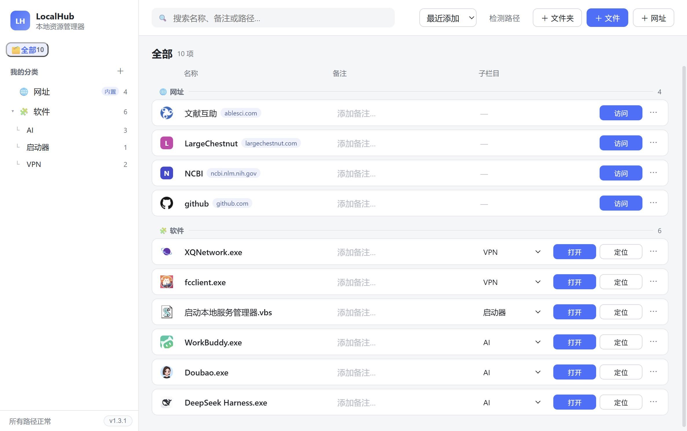
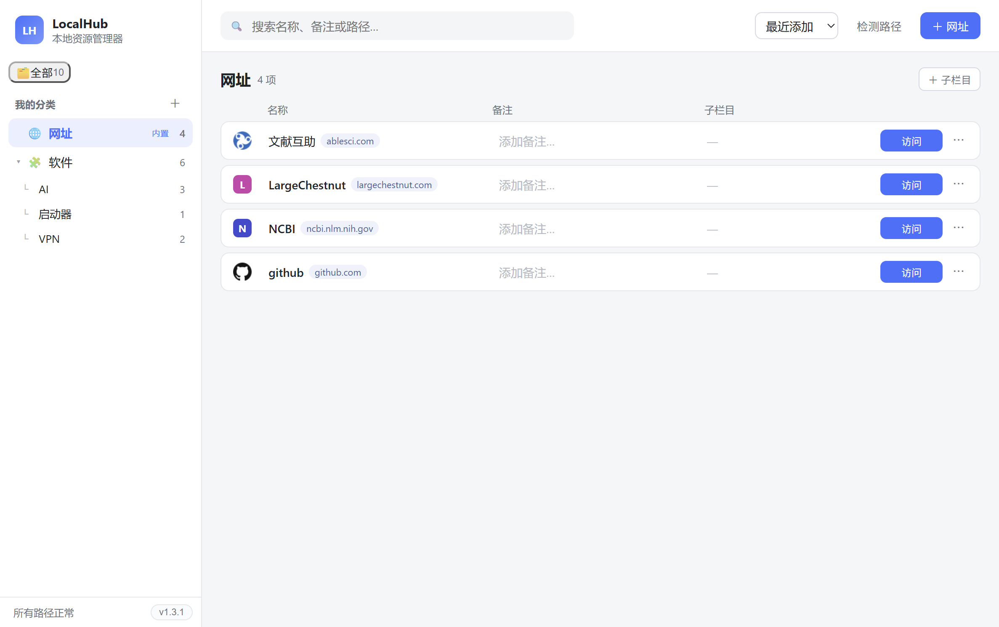
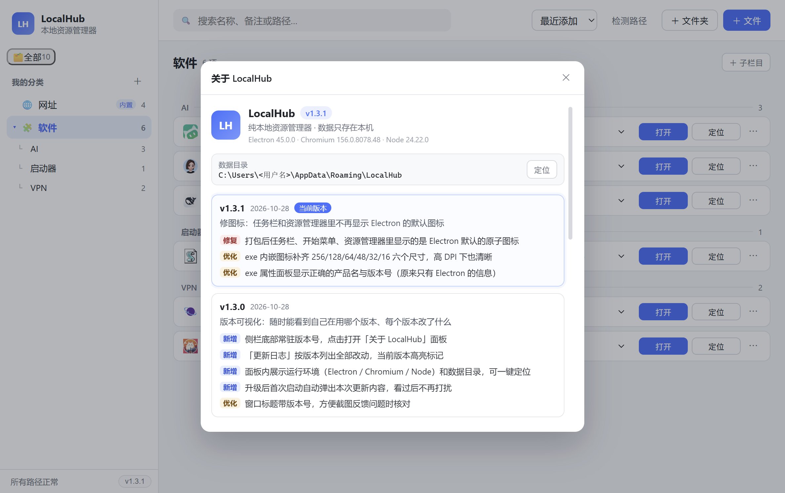

# LocalHub · 本地资源和软件管理器

把散落在硬盘各处的**软件、文件夹**和常用**网址**，收进一张清单里。要用的时候点一下就打开，或者一键跳到它所在的文件夹。

**完全本地运行，不需要注册账号，数据不出本机。**

---

## 下载

> ### [下载 LocalHub-1.3.1-Setup.exe（108 MB）](https://github.com/YOUR-NAME/localhub/releases/latest)

双击安装，开始菜单和桌面会有快捷方式。升级也是直接下载新版 Setup 覆盖安装，**不会动你的清单数据**。

> 要求：Windows 10 / 11，64 位。安装包较大是因为它内置了完整运行环境，不需要你额外装任何东西。
> 想要不安装的便携版的话，可以自己用源码编译一份，方法见 [开发文档](./DEVELOPMENT.md)。

---

## 它长什么样

左侧是分类，右侧是一条条的清单。没有菜单栏，没有嵌套面板，想要的东西都在一眼能看到的地方。

网址栏目：

侧栏左下角点版本号，可以看到完整更新日志：

---

## 三分钟上手

**1. 装好打开** — 第一次运行是空的，软件不会偷偷扫描你的硬盘。

**2. 把东西拖进来** — 从资源管理器把 exe、文件夹直接拖进窗口，或者点工具栏的「＋ 文件」「＋ 文件夹」手动选择。
常用网址同理：点「＋ 网址」填进去，或者把浏览器地址栏左边的链接图标直接拖进来。

**3. 点一下就用** —

| 按钮 | 作用 |
| --- | --- |
| **打开** | 直接用系统默认方式启动（网址则用浏览器打开） |
| **定位** | 在资源管理器里选中并跳到它所在的位置 |

建议上来先建两个分类：一个「软件」，一个「网址」。图标会自动读取，不用管。

---

## 为什么要用它

装软件时总默认它会在桌面留个快捷方式，但你卸载过几次之后，桌面早就乱了；还有一批绿色软件躺在 `D:\某个很深的目录` 里，每次找都要重开资源管理器翻一遍。

LocalHub 就是把这个「找」的动作省掉：东西还是在你原来的位置，只是这儿有了一份清单。

具体到功能：

- **分类 + 子栏目** —— 「软件」下面可以再分「AI 工具」「影音」，层级随便调整
- **文件和网址放一起** —— 本地程序和常用网站不必分开两处记录
- **真实图标** —— 显示的是程序自己的图标，不是系统给的白纸
- **拖进来就行** —— 不用点「添加」再翻一遍目录
- **随手加备注** —— 行内直接编辑，写「这是干嘛的」「密码是 xxx」
- **路径失效会标红** —— 文件被挪走或删了，条目会变红并禁用按钮，不会点了才发现打不开
- **按钮有回执** —— 点了「打开」，按钮会变成「打开中… → ✓ 已打开」，失败则显示红色原因

---

## 常见问题

**数据存在哪里？**
`C:\Users\<你的用户名>\AppData\Roaming\LocalHub\data.json`，图标缓存在同目录的 `icon-cache` 文件夹。
**卸载软件不会删这个文件**，重装回来列表还在。想彻底清空，把整个 `LocalHub` 文件夹删掉即可。

**会不会上传我的数据到服务器？**
不会。软件没有任何同步逻辑，唯一联网的地方是抓取网址条目的图标——抓到后就存本地，不会重复请求。

**为什么安装包有 108 MB？**
因为它内置了完整的浏览器内核和运行时。好处是不依赖系统里的任何组件，装上就能跑；代价就是体积大，这是这类桌面应用的通病。

**Windows 提示"未知发布者"怎么办？**
安装包没有购买代码签名证书（个人开发者成本较高）。点「更多信息 → 仍要运行」即可。源码全部公开，介意的话可以自己编译。

**能把清单导出给别人吗？**
数据就是上面那个 `data.json`，纯文本。复制给别人，对方放进同样的目录就能用。

---

## 更新日志

| 版本 | 日期 | 说明 |
| --- | --- | --- |
| 1.3.1 | 2026-10-28 | 修复任务栏图标显示为 Electron 默认图标的问题 |
| 1.3.0 | 2026-10-28 | 侧栏显示版本号，「关于」面板可查看完整更新日志，升级后自动提示 |
| 1.2.0 | 2026-10-28 | 按钮四态反馈，失败时给出具体原因 |
| 1.1.0 | 2026-10-26 | 新增网址管理与图标抓取 |
| 1.0.0 | 2026-10-23 | 首个版本 |

每一条改动的详细展开，可以在软件里点侧栏左下角的版本号查看。

---

## 开发者

想自己编译、改代码或了解实现细节（构建、打包、数据格式、发版流程）：[DEVELOPMENT.md](./DEVELOPMENT.md)
